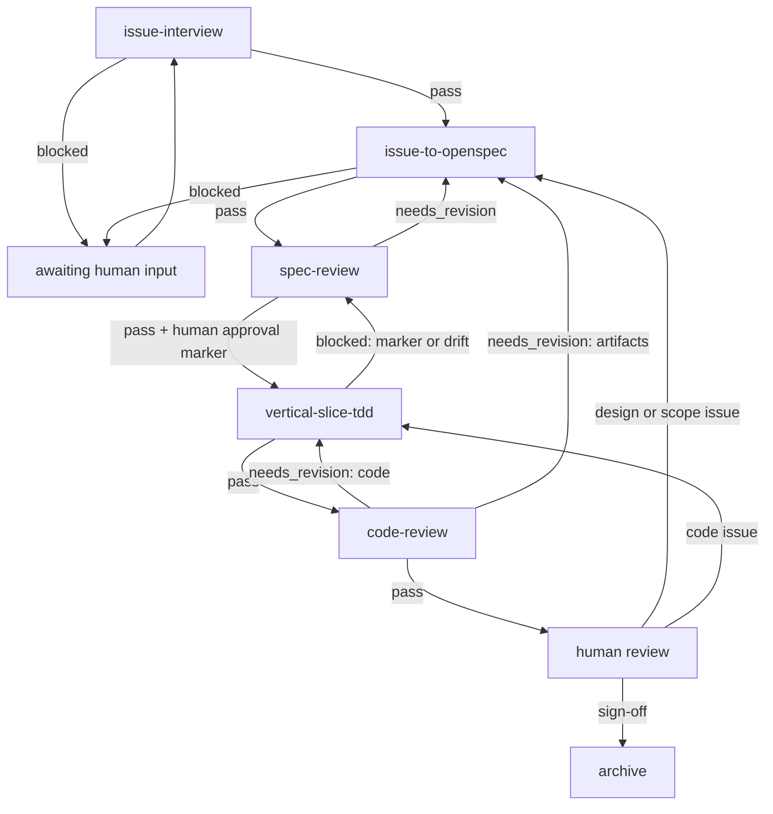

# Workflow and delivery

The skills own stages. The persona owns delivery. This document owns the stage
graph, loop limits, and human gates. Labels and comment formats are examples; the
agent file defines the real operations.

## Boundary

| Layer | Owns |
|---|---|
| Skill | Stage process, completion criteria, findings, and a verdict: `pass`, `needs_revision`, or `blocked`, with a one-line reason |
| Persona / agent file | Role, task, tools, tracker and review operations, approval marker, workspace and push policy |
| Workflow | Which stage runs next, loop limits, escalation, and when to wait for a human |

A stage skill does not invoke another stage skill and does not assume a specific
tracker or label CLI. It may invoke OpenSpec and the named supporting skills. The
skill reports what happened; the persona decides how to deliver it.

## Why verdicts

Skills used to emit `routing_status`, `owner`, and `requested_action`. That made
delivery policy a skill concern: two skills needed an explicit "ready means
workflow" rule to match this document, and the rule could not be tested against a
real persona.

Alternatives rejected: keeping all three fields, which duplicates delivery policy
in every stage; and moving all routing to an external orchestrator, which the
persona already is, and which would leave a skill unable to say "blocked because
input is missing".

Consequence: the verdict and reason are the whole contract. This document owns
the stage graph and gates; the agent file owns the tracker operations, labels,
review state, and push policy.

## Verdict

Every stage ends with:

```
verdict: pass | needs_revision | blocked
reason: <one line naming the defect and the stage or input that can resolve it>
```

- `pass`: the stage is complete. The persona advances, or asks for the human
  gate the stage requires.
- `needs_revision`: a defect the owning stage can fix. The reason names the
  failing artifact or code and the stage that owns it.
- `blocked`: a human or upstream input is required. The reason names what is
  missing. The stage cannot proceed until it arrives.

The persona maps the verdict and reason to comments, labels, review state,
commits, and pull requests. Skills never name those operations.

## Stage graph



This is the happy path plus the named exceptions. Human review can still send a
design issue back to the spec writer; that reopens the spec gate and invalidates
the prior approval marker. The `blocked` wait is not a retry: the stage cannot
proceed until a human answers.

## Verdicts by stage

| Stage | `pass` means | `needs_revision` means | `blocked` means |
|---|---|---|---|
| `issue-interview` | The issue bodies are confirmed and published | — | A required section or answer is missing |
| `issue-to-openspec` | The change is proposed and validates strictly | Artifacts changed after review and need an update | The issue is missing context |
| `spec-review` | Ready for spec approval | A defect in the issue, the spec, the design, or the tasks | A required source is unavailable |
| `vertical-slice-tdd` | Every task is implemented and the suite is green | — | The approval marker is absent or the artifacts drifted |
| `code-review` | Ready for human sign-off | A code or artifact defect | The diff or a required source is unavailable |

## Persona delivery

The agent file decides how each verdict is delivered. Typical mappings:

| Verdict | Example delivery |
|---|---|
| `pass` at `issue-interview` | Publish the issues, then start `issue-to-openspec` |
| `blocked` at `issue-to-openspec` | Comment the questions on the issue, mark it awaiting information, stop |
| `needs_revision` at `spec-review` | Post findings as review comments and request changes |
| `pass` at `spec-review` | Ask the human to record the approval marker |
| `blocked` at `vertical-slice-tdd` | Ask for the missing marker or artifact fix; do not implement |
| `needs_revision` at `code-review` | Post review comments and request changes |
| `pass` at `code-review` | Ask the human for sign-off; archive only after it |

An agent file may use different operations for the same verdict. The skill's job
is to make the verdict and reason unambiguous, not to choose the tracker
mechanics.

## Human-information loop versus rework loop

**Human-information loop.** The stage cannot proceed because input is missing.
This is a blocking state, not an agent retry.

```
stage
  -> report blocked with the missing input
  -> persona posts the questions and marks the work awaiting information
  -> stop
  -> a human answers
  -> the same stage reruns
```

**Rework loop.** A reviewer found a defect in an artifact or code the owning
stage can fix. This can run agent-to-agent.

```
reviewer
  -> report needs_revision naming the defect and owning stage
  -> persona posts findings and requests changes
  -> the owning stage reruns
  -> the reviewer reruns on new commits
```

## GitHub mapping

Normalize the reason to one semantic action before mapping it to a tracker. The
agent file chooses the actual command or label.

| Semantic action | Typical verdict | Example operation |
|---|---|---|
| `publish_issues` | `pass` at `issue-interview` | `gh issue create`, or the configured tracker operation |
| `request_information` | `blocked` with a missing input | Comment the questions; add the waiting label; stop |
| `request_spec_changes` | `needs_revision` in `spec-review` with an artifact cause | Request changes on the PR that owns the artifacts; rerun `issue-to-openspec` on new commits |
| `request_code_changes` | `needs_revision` in `code-review` with a code cause | Request changes on the PR; rerun `vertical-slice-tdd` on new commits |
| `approve_spec` | `pass` at `spec-review` | Human sets the configured approval marker |
| `sign_off_code` | `pass` at `code-review` | Human approves; then archive with the OpenSpec archive workflow |
| `human_review_change` | Human raises a design or scope issue | Comment; return to `issue-to-openspec` and `spec-review`; require a new marker |
| `blocked_design_drift` | `blocked` at `vertical-slice-tdd` with drift | Comment the drift; return to `issue-to-openspec` and `spec-review` |

Review comments belong on the PR or issue that owns the artifact. A status
hidden in chat is not a delivery.

## Archive

Archive is the OpenSpec finalization step (`openspec-archive-change`), not a
review stage. It runs after human sign-off and no open design change. It checks
artifact and task completion, optionally syncs delta specs into the main specs,
moves the change into the archive directory, and commits the result.

## Workflow rules

- **Only loop on a named cause.** `needs_revision` must name the failing
  artifact or code. A verdict without a cause is a human escalation.
- **Cap rework.** Three reviewer cycles, then stop and ask. Spec and code loops
  can otherwise oscillate.
- **Require new evidence.** Re-run a reviewer only after the owning stage changed
  an artifact or commit. Do not re-review an unchanged tree.
- **Do not auto-retry human blocks.** A `blocked` verdict waits for a human; it
  is not a failed agent run.
- **Keep human gates fixed.** Auto-rework may fix findings, but implementation
  still needs the approval marker and merge still needs sign-off.
- **Human review can reopen the spec.** A design or scope finding at the final
  gate returns to `issue-to-openspec` and `spec-review`. A spec change invalidates
  the prior approval marker, so implementation waits for a new one.
- **Archive only after sign-off.** Archive runs when the human accepts the result
  and no design change is open.
- **Escalate silent narrowing.** If a fix would weaken a requirement, stop and
  ask instead of looping.
- **One cause per finding.** Artifact findings name the artifacts; code findings
  name the code; unclear scope names the missing decision.

## Example: spec reviewer finds a missing requirement

```
spec-review
  verdict: needs_revision
  reason: the spec delta drops the issue's per-user scoping requirement
```

The persona posts the finding as a review comment, requests changes, and reruns
`issue-to-openspec` on new commits. The change does not reach implementation.

## Example: code reviewer finds a test gap

```
code-review
  verdict: needs_revision
  reason: the whitespace branch has no regression test; suite passes without it
```

The persona posts review comments and requests changes. `vertical-slice-tdd`
reruns on new commits, then `code-review` reruns.

## Example: human review raises a design issue

```
code-review
  verdict: pass
  reason: implementation matches the approved change; ready for sign-off
```

The human reviews and decides the design is wrong. The persona returns to
`issue-to-openspec` and `spec-review`; the prior approval marker no longer
applies. Implementation waits for a new marker.
