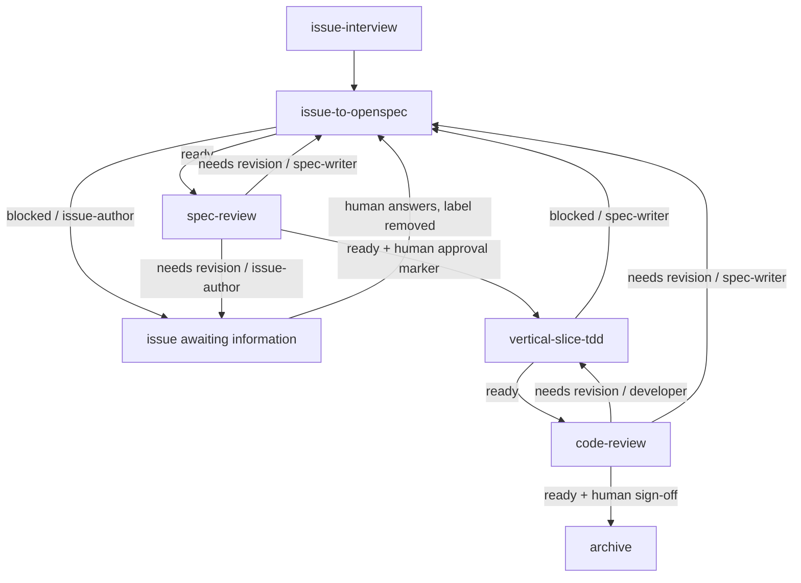

# Workflow and GitHub mapping

The skills own stages. This document owns the loop routing and the GitHub
artifacts that carry it. Labels and comment formats are examples; the agent file
defines the real ones for a repository.

## Boundary

| Layer | Owns |
|---|---|
| Skill | Stage process, completion criteria, findings, and a semantic routing result: `routing_status`, `owner`, `requested_action` |
| Workflow | Which stage runs next, loop limits, escalation, and when to wait for a human |
| Agent file | GitHub mechanics: comments, labels, review state, workspace policy |

A stage skill does not invoke another stage skill and does not assume a specific
tracker or label CLI. It may invoke OpenSpec and the named supporting skills.

## Routing result

Every stage ends with:

```
routing_status: ready | blocked | needs_revision
owner: issue-author | spec-writer | developer | workflow | human
requested_action: <what the environment should do next>
```

The workflow routes on `routing_status` and `owner`; the agent file maps
`requested_action` to GitHub operations. `owner` is the blocking owner. Use
`workflow` when the next action is simply the next stage.

## States



This is the happy path plus the named exceptions. The `needs-information` wait
can sit on the `issue-to-openspec` or `spec-review` edge. It is not a retry: the
stage cannot proceed until a human answers.

## Human-information loop versus rework loop

**Human-information loop.** The spec writer cannot proceed because the issue is
missing context. This is a blocking state, not an agent retry.

```
spec writer
  -> post questions on the issue
  -> add needs-information
  -> stop
  -> wait for a human answer
  -> remove needs-information
  -> rerun the spec writer
```

**Rework loop.** A reviewer found a defect in an artifact the owner can fix.
This can run agent-to-agent.

```
spec-review
  -> post findings as review comments
  -> request changes
  -> rerun issue-to-openspec
  -> new commits
  -> rerun spec-review
```

## GitHub mapping

Normalize the prose in a skill's `requested_action` to one of these semantic
actions before mapping it to GitHub.

| Semantic action | Skill `requested_action` examples | GitHub operation |
|---|---|---|
| `publish_issues` | "publish issues" | `gh issue create` or the configured tracker operation |
| `request_information` | "answer the missing questions", "post questions on the issue" | `gh issue comment <n> --body-file -` and `gh issue edit <n> --add-label needs-information`; wait |
| `request_spec_changes` | "post findings as review comments and request changes", "update the spec artifacts" | `gh pr review <n> --request-changes --body-file -`; inline comments for file-level findings; rerun `issue-to-openspec` on new commits |
| `request_code_changes` | "post review comments and request changes" | `gh pr review <n> --request-changes --body-file -`; inline comments; rerun `vertical-slice-tdd` on new commits |
| `approve_spec` | "record approval" | Human sets the configured approval marker, for example a `ready-for-dev` label |
| `sign_off_code` | "human sign-off" | Human approves the PR; then the change owner archives with the OpenSpec archive workflow |
| `blocked_design_drift` | "update the artifacts" | Comment on the change or PR with the drift; return to `issue-to-openspec` and `spec-review` |

Review comments belong on the PR that owns the artifact. A status hidden in chat
is not a routing signal.

## Workflow rules

- **Only loop on a named owner.** `needs_revision` without an owner is a human
  escalation.
- **Cap rework.** Three reviewer cycles, then stop and ask. Spec and code loops
  can otherwise oscillate.
- **Require new evidence.** Re-run a reviewer only after the owning stage changed
  an artifact or commit. Do not re-review an unchanged tree.
- **Do not auto-retry human-information blocks.** `needs-information` waits for a
  human; it is not a failed agent run.
- **Keep human gates fixed.** Auto-rework may fix findings, but implementation
  still needs the approval marker and merge still needs sign-off.
- **Escalate silent narrowing.** If a fix would weaken a requirement, stop and
  ask instead of looping.
- **One owner per finding.** Artifact findings go to `spec-writer`; code findings
  go to `developer`; unclear scope goes to `issue-author` or `human`.

## Example: spec reviewer finds a missing requirement

```
spec-review
  routing_status: needs_revision
  owner: issue-author
  requested_action: post questions on the issue and add needs-information
        |
        v
issue comment + needs-information
        |
        v
human answers, label removed
        |
        v
issue-to-openspec reruns, updates the proposal and spec delta
        |
        v
spec-review reruns
```

## Example: code reviewer finds a test gap

```
code-review
  routing_status: needs_revision
  owner: developer
  requested_action: post review comments and request changes
        |
        v
PR review: changes requested
        |
        v
vertical-slice-tdd reruns on new commits
        |
        v
code-review reruns
```
